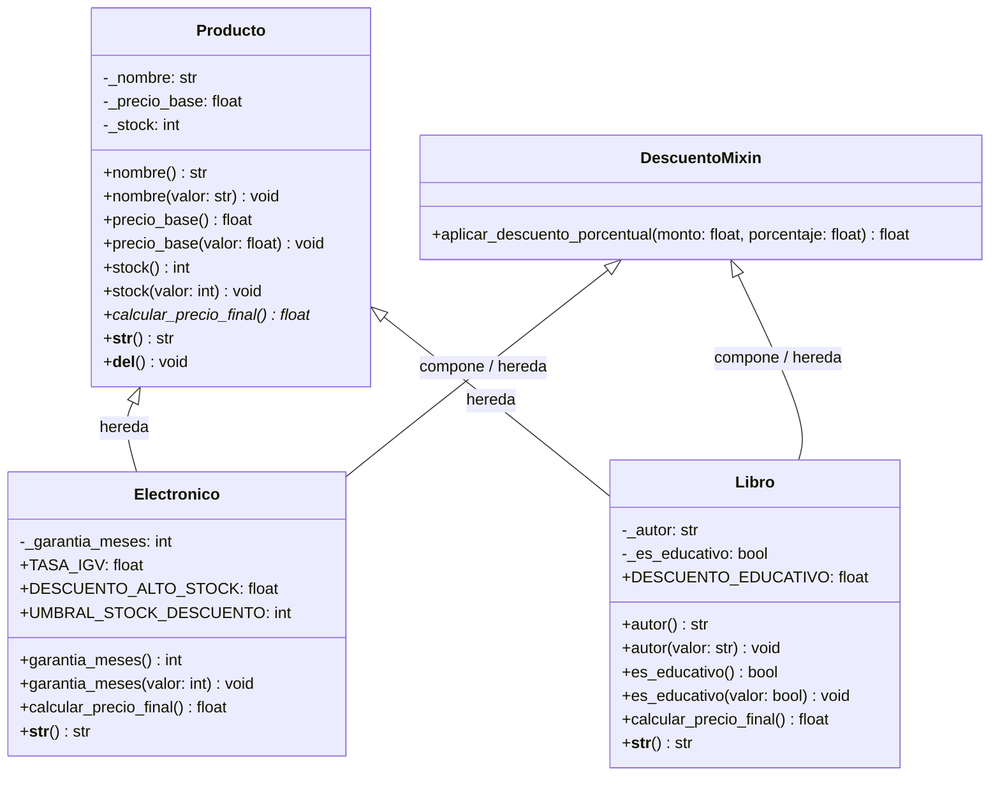

# INFORME TÉCNICO DE ARQUITECTURA Y DESARROLLO DE SOFTWARE

**PROYECTO:** NexusStore Core CLI  
**SISTEMA:** Motor de Gestión de Inventario, Catálogo y Facturación Comercial  
**LENGUAJE:** Python 3.11+ / 3.12+ / 3.14  
**VERSIÓN:** 1.0.0  
**ESTADO:** Producción / Estable  

---

## 1. RESUMEN EJECUTIVO Y ALCANCE

El proyecto **NexusStore Core CLI** es una solución por línea de comandos orientada a la gestión automatizada de catálogos e inventarios comerciales de artículos tecnológicos y obras editoriales especializadas. Su arquitectura implementa un modelo de dominio fuertemente tipado que resuelve cálculos impositivos (IGV), descuentos por volumen y exenciones tributarias de fomento cultural.

### Objetivos Técnicos Alcanzados:
- **Desacoplamiento Modular:** Separación estricta de responsabilidades entre el orquestador (`main.py`), modelos de dominio (`models/`) y utilitarios transversales (`utils/`).
- **Encapsulamiento Completo:** Protección de estado interno mediante atributos protegidos y mutación supervisada con decoradores `@property`.
- **Polimorfismo:** Interfaz uniforme para el cálculo de precios y serialización legible.
- **Herencia Múltiple Cooperativa:** Integración de `DescuentoMixin` bajo el algoritmo de linealización C3 (MRO).
- **Tolerancia a Fallos:** Manejo defensivo de excepciones personalizadas mediante estructuras `try/except/else/finally`.

---

## 2. ARQUITECTURA POO Y DISEÑO ESTRUCTURAL

### 2.1 Jerarquía de Clases
El dominio se estructura en torno a una entidad base `Producto` que abstrae las propiedades universales de cualquier artículo en stock, mientras que las subclases especializadas `Electronico` y `Libro` extienden dicho comportamiento adaptándose a sus normativas fiscales y comerciales:

1. **`Producto` (Base):**
   - Atributos protegidos: `_nombre` (str), `_precio_base` (float), `_stock` (int).
   - Acceso: `@property` y setters con validación de rangos numéricos y cadenas no vacías.
   - Contrato abstracto: `calcular_precio_final()` que obliga a las subclases a sobreescribirlo.
   - Destructor: `__del__()` para trazabilidad de recolección de memoria.

2. **`DescuentoMixin` (Mixin):**
   - Provee el método `aplicar_descuento_porcentual(monto, porcentaje)`.
   - No define constructor propio para no distorsionar el MRO de las clases hijas.

3. **`Electronico` (Subclase de `Producto` y `DescuentoMixin`):**
   - Atributo protegido: `_garantia_meses` (int $\ge 0$).
   - Regla de negocio: Aplica IGV del 18%. Si el stock es mayor a 50 unidades, aplica un 10% de descuento comercial por volumen antes del cálculo tributario.

4. **`Libro` (Subclase de `Producto` y `DescuentoMixin`):**
   - Atributos protegidos: `_autor` (str), `_es_educativo` (bool).
   - Regla de negocio: Exonerado de IGV (0%). Si califica como educativo o técnico, aplica un 10% de descuento sobre el precio base.

---

### 2.2 Diagrama de Clases UML



---

## 3. ANÁLISIS DE MRO (METHOD RESOLUTION ORDER) Y C3 LINEARIZATION

Python resuelve la herencia múltiple mediante el algoritmo de **Linealización C3**, asegurando monotonicidad y respetando el orden local de precedencia sin ambigüedades.

### Resolución de la Jerarquía en NexusStore:
```python
>>> Electronico.__mro__
(
    <class 'models.producto.Electronico'>,
    <class 'models.producto.Producto'>,
    <class 'models.producto.DescuentoMixin'>,
    <class 'object'>
)
```

### Justificación Técnica del Orden:
1. **Búsqueda Jerárquica:** Al invocar un método o atributo, Python consulta en primer lugar la propia clase (`Electronico`), luego la clase base (`Producto`), posteriormente el mixin utilitario (`DescuentoMixin`), y finalmente la raíz (`object`).
2. **Uso de `super()`:** En el constructor `Electronico.__init__`, la llamada `super().__init__(nombre, precio_base, stock)` localiza directamente a `Producto.__init__`. Como `DescuentoMixin` carece de estado interno y no implementa un `__init__` colisionante, se evita cualquier degradación en la cadena de inicialización o inconsistencia de argumentos.

---

## 4. ANÁLISIS COMPARATIVO: HERENCIA VS. COMPOSICIÓN

| Criterio | Herencia Aplicada | Composición Alternativa | Decisión Tomada |
| :--- | :--- | :--- | :--- |
| **Relación Semántica** | "Es un" (*Is-a*): `Electronico` y `Libro` son instancias directas de artículos del catálogo. | "Tiene un" (*Has-a*): Un producto tiene una estrategia de precio. | Se adoptó **Herencia** por fidelidad taxonómica al catálogo. |
| **Polimorfismo CLI** | El orquestador ejecuta `item.calcular_precio_final()` sin conocer la subclase. | Requeriría inyectar clases de servicio (*Strategy Pattern*) para cada item. | La herencia reduce la sobrecarga cognitiva y agiliza la invocación en la interfaz. |
| **Funcionalidad Mixin** | `DescuentoMixin` reutiliza lógica matemática transversal sin duplicar código. | Se requeriría un objeto colaborador `DescuentoService` dentro de cada entidad. | El Mixin aporta ligereza, bajo acoplamiento y consumo nulo de memoria por instancia. |

---

## 5. ENCAPSULAMIENTO Y SANITIZACIÓN DE DATOS

Para evitar que el estado interno sea corrompido, se aplicaron las siguientes reglas en los setters de dominio:

- **`nombre` y `autor`:** Se exige que el valor sea de tipo cadena y no esté compuesto únicamente por espacios en blanco (`strip()`). De lo contrario, se dispara `ValidationError`.
- **`precio_base`:** Se valida numéricamente contra el rango $(0, +\infty\rangle$. Cualquier valor menor o igual a 0 genera un `ValidationError`.
- **`stock` y `garantia_meses`:** Se verifica que correspondan a números enteros y pertenezcan al rango $[0, +\infty\rangle$.

---

## 6. GESTIÓN ROBUSTA DE EXCEPCIONES (`try / except / else / finally`)

El flujo principal en `main.py` garantiza que ninguna entrada incorrecta aborte el proceso intempestivamente:

```python
try:
    opcion = menu()
    # Ejecución de operaciones según la opción elegida...
except ValidationError as e:
    hubo_error = True
    print(f"\n⚠️  Error de validación: {e}")
except NotFoundError as e:
    hubo_error = True
    print(f"\n🔍 No encontrado: {e}")
except Exception as e:
    hubo_error = True
    print(f"\n❌ Error inesperado: {e}")
else:
    # Se ejecuta exclusivamente cuando no se levantó ninguna excepción
    pass
finally:
    # Se ejecuta en todas las iteraciones para limpieza y delimitación
    if hubo_error:
        print("ℹ️  Revise los datos ingresados e intente nuevamente.")
```

---

## 7. MATRIZ DE ASIGNACIÓN DE ROLES TÉCNICOS

| Rol | Responsabilidades Clave Cumplidas |
| :--- | :--- |
| **Arquitecto POO** | Diseño del diagrama UML, definición de clases base, subclases, Mixin y verificación de MRO con `super()`. |
| **Desarrollador de Lógica** | Implementación del bucle CLI, gestión del diccionario en memoria `inventario: dict[int, Producto]`, menú interactivo y formatos de salida. |
| **Ingeniero de Validación & Excepciones** | Definición de `ValidationError`, `NotFoundError`, validadores numéricos y de texto, setters controlados con `@property`. |
| **QA & Documentador** | Validación de compatibilidad Python 3.11+, formato conforme a directrices PEP 8, redacción del `README.md` y compilación de trazas de ejecución. |

---

## 8. GUÍA DETALLADA DE CAPTURAS REQUERIDAS

A continuación se indica **exactamente qué captura tomar**, **qué debe verse en pantalla** y **en qué sección del informe o entrega debe insertarse**:

```
+----------------------------------------------------------------------------------------------------+
| GUÍA RÁPIDA DE COLOCACIÓN DE CAPTURAS                                                              |
|                                                                                                    |
| [Sección 8.1] -> Captura 1: Caso Exitoso (Ruta Feliz: Crear, Listar y Cotizar)                     |
| [Sección 8.2] -> Captura 2: Excepción Capturada 1 (ValidationError: Categoría o Rango Inválido)    |
| [Sección 8.3] -> Captura 3: Excepción Capturada 2 (NotFoundError: ID Inexistente)                  |
| [Sección 8.4] -> Captura 4 (Opcional): Activación del Destructor __del__ al Salir del Sistema      |
+----------------------------------------------------------------------------------------------------+
```

### 8.1 CAPTURA 1: CASO EXITOSO (RUTA FELIZ)
- **Ubicación en el informe:** Capítulo de *Pruebas de Funcionalidad* o *Resultados de Ejecución*.
- **Qué debe mostrar la captura:**
  1. Registro de un producto **Electrónico** con stock $> 50$ (para activar el descuento por volumen del 10% e IGV del 18%).
  2. Registro de un **Libro** educativo (para activar exención de IGV y descuento educativo del 10%).
  3. Listado completo de productos mediante la opción `2`.
  4. Cotización del precio final mediante la opción `3` para ambos productos.

#### 📋 Texto exacto que debe observarse en la consola para la Captura 1:
```text
==========================================
=== GESTIÓN DE PRODUCTOS (CLI) ===
==========================================
1. Agregar Producto
2. Listar Productos
3. Calcular Precio Final
4. Salir
------------------------------------------
Opción > 1
Ingrese categoría (electronico / libro): electronico
Nombre del producto: Monitor Gamer 27 Pulgadas
Precio base (S/): 1200
Cantidad en stock: 55
Meses de garantía: 36

✅ Producto agregado con éxito. Asignado con ID #1.

==========================================
=== GESTIÓN DE PRODUCTOS (CLI) ===
==========================================
1. Agregar Producto
2. Listar Productos
3. Calcular Precio Final
4. Salir
------------------------------------------
Opción > 1
Ingrese categoría (electronico / libro): libro
Nombre del producto: Clean Code
Precio base (S/): 120
Cantidad en stock: 15
Autor del libro: Robert C. Martin
¿Es libro educativo / texto técnico? (s/n): s

✅ Producto agregado con éxito. Asignado con ID #2.

==========================================
=== GESTIÓN DE PRODUCTOS (CLI) ===
==========================================
1. Agregar Producto
2. Listar Productos
3. Calcular Precio Final
4. Salir
------------------------------------------
Opción > 2

---------------------------------------------------------------------------
ID     | DETALLE Y ESPECIFICACIONES                                       
---------------------------------------------------------------------------
#1     | [Electronico] Monitor Gamer 27 Pulgadas | S/ 1200.00 | Stock: 55 | Garantía: 36 meses (Descuento por stock > 50 aplicable)
#2     | [Libro] Clean Code | S/ 120.00 | Stock: 15 | Autor: Robert C. Martin | Tipo: Educativo / Técnico (Exento IGV)
---------------------------------------------------------------------------
Total de registros: 2

==========================================
=== GESTIÓN DE PRODUCTOS (CLI) ===
==========================================
1. Agregar Producto
2. Listar Productos
3. Calcular Precio Final
4. Salir
------------------------------------------
Opción > 3
Ingrese el ID del producto a cotizar: 1

--------------------------------------------------
💰 COTIZACIÓN DE PRECIO FINAL: ID #1
--------------------------------------------------
• Producto       : Monitor Gamer 27 Pulgadas
• Categoría      : Electronico
• Precio Base    : S/ 1200.00
• Stock Actual   : 55 unidades
• Descuento Vol. : -10.0% (Stock > 50)
• Tasa Impuesto  : IGV (18%)
• Garantía       : 36 meses
--------------------------------------------------
➡️  PRECIO FINAL DE VENTA: S/ 1274.40
--------------------------------------------------

==========================================
=== GESTIÓN DE PRODUCTOS (CLI) ===
==========================================
1. Agregar Producto
2. Listar Productos
3. Calcular Precio Final
4. Salir
------------------------------------------
Opción > 3
Ingrese el ID del producto a cotizar: 2

--------------------------------------------------
💰 COTIZACIÓN DE PRECIO FINAL: ID #2
--------------------------------------------------
• Producto       : Clean Code
• Categoría      : Libro
• Precio Base    : S/ 120.00
• Stock Actual   : 15 unidades
• Autor          : Robert C. Martin
• Régimen Libro  : Educativo / Técnico (-10%) | Exonerado de IGV (0%)
--------------------------------------------------
➡️  PRECIO FINAL DE VENTA: S/ 108.00
--------------------------------------------------
```

---

### 8.2 CAPTURA 2: EXCEPCIÓN CAPTURADA `ValidationError`
- **Ubicación en el informe:** Subsección de *Validaciones y Manejo de Errores de Entrada*.
- **Qué debe mostrar la captura:**
  - El usuario ingresa a la opción `1` e intenta ingresar una categoría no permitida (por ejemplo: `componentes_pc` o `ropa`), o un valor negativo/no numérico en precio/stock.
  - El sistema intercepta el error mediante el bloque `except ValidationError as e:` y emite el mensaje formativo junto con la advertencia del bloque `finally`.

#### 📋 Texto exacto que debe observarse en la consola para la Captura 2:
```text
==========================================
=== GESTIÓN DE PRODUCTOS (CLI) ===
==========================================
1. Agregar Producto
2. Listar Productos
3. Calcular Precio Final
4. Salir
------------------------------------------
Opción > 1
Ingrese categoría (electronico / libro): componentes_pc

⚠️  Error de validación: Categoría no válida: 'componentes_pc'. Opciones disponibles: 'electronico', 'libro'.
ℹ️  Revise los datos ingresados e intente nuevamente.
```

---

### 8.3 CAPTURA 3: EXCEPCIÓN CAPTURADA `NotFoundError`
- **Ubicación en el informe:** Subsección de *Manejo de Errores de Búsqueda y Catálogo*.
- **Qué debe mostrar la captura:**
  - El usuario ingresa a la opción `3` (Calcular Precio Final) y digita un identificador que no existe en el diccionario del inventario (por ejemplo: `999`).
  - El sistema dispara `NotFoundError`, el bloque `except NotFoundError as e:` atrapa la excepción y muestra el aviso correspondiente sin caerse.

#### 📋 Texto exacto que debe observarse en la consola para la Captura 3:
```text
==========================================
=== GESTIÓN DE PRODUCTOS (CLI) ===
==========================================
1. Agregar Producto
2. Listar Productos
3. Calcular Precio Final
4. Salir
------------------------------------------
Opción > 3
Ingrese el ID del producto a cotizar: 999

🔍 No encontrado: No existe ningún producto registrado con el ID #999.
ℹ️  Revise los datos ingresados e intente nuevamente.
```

---

### 8.4 CAPTURA 4 (RECOMENDADA): ACTIVACIÓN DEL DESTRUCTOR `__del__`
- **Ubicación en el informe:** Subsección de *Ciclo de Vida de Objetos y Destructores*.
- **Qué debe mostrar la captura:**
  - El usuario selecciona la opción `4` (Salir) tras haber agregado productos.
  - Se visualiza el mensaje de cierre y las trazas generadas por el recolector de basura al destruir las instancias.

#### 📋 Texto exacto que debe observarse en la consola para la Captura 4:
```text
==========================================
=== GESTIÓN DE PRODUCTOS (CLI) ===
==========================================
1. Agregar Producto
2. Listar Productos
3. Calcular Precio Final
4. Salir
------------------------------------------
Opción > 4

Cerrando sistema... ¡Hasta luego!
🗑️  Destruyendo instancia: Monitor Gamer 27 Pulgadas
🗑️  Destruyendo instancia: Clean Code
```

---

## 9. CONCLUSIONES TÉCNICAS

1. **Adherencia a Principios SOLID:** El sistema cumple con el principio de Responsabilidad Única (SRP) mediante paquetes especializados, y el principio de Abierto/Cerrado (OCP) gracias a la clase abstracta `Producto` y sus métodos polimórficos.
2. **Robustez en Runtime:** La aplicación de decoradores `@property` combinada con la jerarquía `InventoryAppError` impide estados inconsistentes en memoria.
3. **Mantenibilidad:** El código cumple de manera integral con los lineamientos del estándar PEP 8, garantizando legibilidad y extensibilidad para futuros módulos como persistencia en base de datos relacional o interfaces REST.

