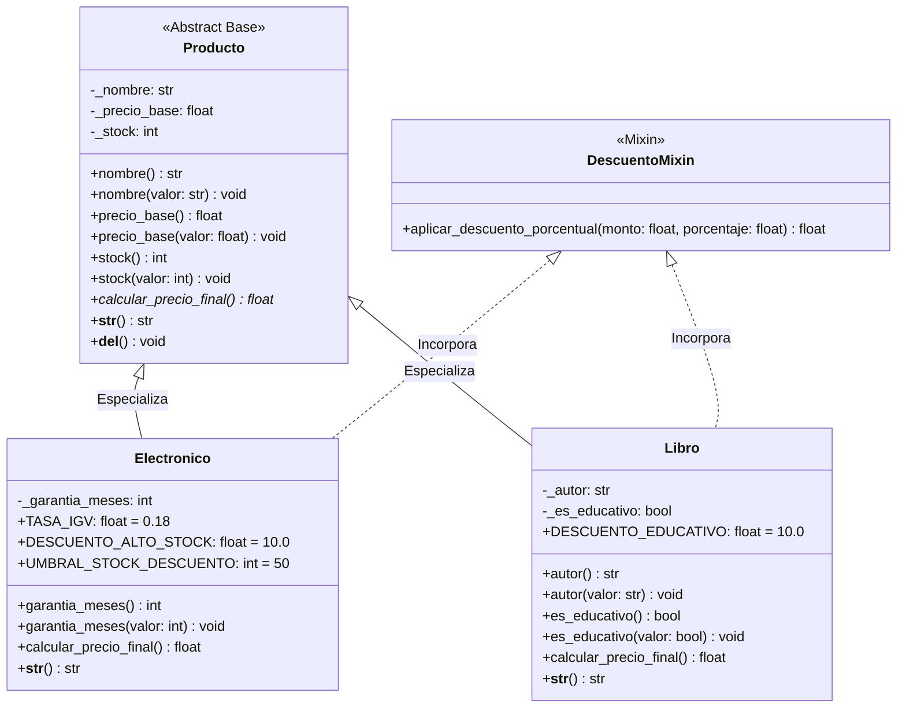

<div align="center">

# ⚡ NexusStore Core CLI
### *Enterprise Product Catalog & Dynamic Pricing CLI System*


<p align="center">
  <b>Sistema empresarial de gestión de catálogo, inventario en memoria y motor polimórfico de cotización comercial para productos tecnológicos y literatura técnica.</b>
</p>

[Características](#-características-principales) •
[Arquitectura UML](#-diagrama-de-clases-uml) •
[MRO y C3](#-análisis-de-mro-y-linealización-c3) •
[Herencia vs Composición](#-herencia-vs-composición) •
[Guía de Uso](#-guía-de-uso-y-ejecución) •
[Evidencias de Ejecución](#-evidencias-de-ejecución)

---

</div>

## 📌 Características Principales

- 🛡️ **Encapsulamiento Riguroso:** Atributos protegidos con validación preventiva vía `@property` y setters restrictivos.
- 🔄 **Polimorfismo Comercial:** Cálculo fiscal dinámico (IGV 18% para electrónicos y 0% para libros bajo exención cultural).
- 🏷️ **Descuentos Inteligentes:** Descuentos por volumen para stock crítico ($>50$ unidades) y bonificaciones para literatura educativa mediante `DescuentoMixin`.
- 🧬 **Herencia Múltiple Cooperativa:** Resolución determinista de métodos mediante linealización C3 y `super()`.
- 🛑 **Tolerancia a Fallos:** Manejo exhaustivo con jerarquía propia (`ValidationError`, `NotFoundError`) en flujo `try / except / else / finally`.
- 🧹 **Ciclo de Vida Controlado:** Notificación de destrucción de instancias mediante `__del__` y recolección de basura.

---

## 📁 Arquitectura y Modularización

El proyecto sigue una separación clara de responsabilidades en tres capas bien delimitadas:

```text
nexusstore-cli/
│
├── main.py                  # 🚀 Orquestador CLI y control de flujo de usuario
├── requirements.txt         # 📦 Entorno y dependencias de calidad
├── README.md                # 📄 Documentación técnica oficial
│
├── models/                  # 🏛️ Capa de Dominio (Modelos POO)
│   ├── __init__.py          # Exportación limpia de clases públicas
│   └── producto.py          # Producto, Electronico, Libro, DescuentoMixin
│
└── utils/                   # 🛠️ Capa Transversal (Utilidades y Validaciones)
    ├── __init__.py          # Exportación de validadores y excepciones
    ├── exceptions.py        # Jerarquía custom: ValidationError, NotFoundError
    └── validators.py        # Sanitización de rangos, tipos y categorías
```

---

## 🏛️ Diagrama de Clases UML



---

## 🧬 Análisis de MRO y Linealización C3

En Python, la herencia múltiple se resuelve mediante el algoritmo **C3 Linearization**, garantizando consistencia y precedencia determinista:

```python
class Electronico(Producto, DescuentoMixin):
    ...
```

### Orden de Resolución en Tiempo de Ejecución:

$$\text{MRO(Electronico)} = [\text{Electronico}, \text{Producto}, \text{DescuentoMixin}, \text{object}]$$

```python
>>> Electronico.__mro__
(
    <class 'models.producto.Electronico'>, 
    <class 'models.producto.Producto'>, 
    <class 'models.producto.DescuentoMixin'>, 
    <class 'object'>
)
```

> [!NOTE]
> **Ventajas del Diseño Cooperativo:**
> 1. **Prioridad del Dominio:** Los métodos de la entidad base `Producto` prevalecen de forma natural.
> 2. **Ausencia del Problema del Diamante:** `DescuentoMixin` aporta únicamente métodos auxiliares de cálculo porcentual sin inicializadores colisionantes (`__init__`), permitiendo que `super().__init__(...)` opere sin fricción.

---

## ⚖️ Herencia vs. Composición

| Criterio | Enfoque Adoptado (Herencia + Mixin) | Enfoque Alternativo (Composición) | Decisión Técnica |
| :--- | :--- | :--- | :--- |
| **Relación Semántica** | **"Es un" (*Is-a*):** `Electronico` y `Libro` son productos con identidad propia de catálogo. | **"Tiene un" (*Has-a*):** Producto tiene un calculador de precios externo. | Se eligió **Herencia** por modelar con fidelidad la taxonomía del negocio. |
| **Polimorfismo en CLI** | Permite colecciones heterogéneas `dict[int, Producto]` e invocaciones directas `prod.calcular_precio_final()`. | Exige inyectar dependencias y evaluar estrategias manualmente en cada ciclo. | El polimorfismo por herencia reduce la complejidad ciclomática del orquestador. |
| **Reutilización Mixin** | Comportamiento transversal composable sin sobrecarga de memoria. | Instanciación redundante de objetos auxiliares por cada producto. | `DescuentoMixin` provee cálculo puro sin almacenar estado superfluo. |

---

## 🛡️ Reglas de Encapsulamiento y Validaciones

Cada entidad protege su integridad mediante decoradores `@property`:

| Atributo | Tipo | Modificador | Regla de Validación Aplicada |
| :--- | :---: | :---: | :--- |
| `_nombre` | `str` | Protegido | No nulo, no vacío tras aplicar `strip()`. |
| `_precio_base` | `float` | Protegido | Numérico mayor a cero ($precio > 0$). |
| `_stock` | `int` | Protegido | Entero no negativo ($stock \ge 0$). |
| `_garantia_meses` | `int` | Protegido | Entero no negativo ($meses \ge 0$). |
| `_autor` | `str` | Protegido | Cadena de texto no vacía. |

> [!TIP]
> Cualquier asignación indebida (por ejemplo `prod.stock = -5`) dispara de inmediato una excepción controlada de tipo `ValidationError`.

---

## 🚦 Flujo de Excepciones Defensivo

El orquestador en `main.py` implementa el patrón **try / except / else / finally** completo:

```python
try:
    opcion = menu()
    # Ejecución de la operación seleccionada
except ValidationError as e:
    hubo_error = True
    print(f"\n⚠️  Error de validación: {e}")
except NotFoundError as e:
    hubo_error = True
    print(f"\n🔍 No encontrado: {e}")
except Exception as e:
    hubo_error = True
    print(f"\n❌ Error inesperado: {e}")
else:
    # Se ejecuta cuando la transacción concluye de forma limpia
    pass
finally:
    # Garantiza limpieza y retroalimentación en cada ciclo del usuario
    if hubo_error:
        print("ℹ️  Revise los datos ingresados e intente nuevamente.")
```

---

## 🖥️ Evidencias de Ejecución

<details open>
<summary><b>1. Caso Exitoso (Ruta Feliz: Registro, Listado y Cotización)</b></summary>

```text
==========================================
=== GESTIÓN DE PRODUCTOS (CLI) ===
==========================================
1. Agregar Producto
2. Listar Productos
3. Calcular Precio Final
4. Salir
------------------------------------------
Opción > 1
Ingrese categoría (electronico / libro): electronico
Nombre del producto: Monitor Gamer 27 Pulgadas
Precio base (S/): 1200
Cantidad en stock: 55
Meses de garantía: 36

✅ Producto agregado con éxito. Asignado con ID #1.

==========================================
=== GESTIÓN DE PRODUCTOS (CLI) ===
==========================================
1. Agregar Producto
2. Listar Productos
3. Calcular Precio Final
4. Salir
------------------------------------------
Opción > 1
Ingrese categoría (electronico / libro): libro
Nombre del producto: Clean Code
Precio base (S/): 120
Cantidad en stock: 15
Autor del libro: Robert C. Martin
¿Es libro educativo / texto técnico? (s/n): s

✅ Producto agregado con éxito. Asignado con ID #2.

==========================================
=== GESTIÓN DE PRODUCTOS (CLI) ===
==========================================
1. Agregar Producto
2. Listar Productos
3. Calcular Precio Final
4. Salir
------------------------------------------
Opción > 2

---------------------------------------------------------------------------
ID     | DETALLE Y ESPECIFICACIONES                                       
---------------------------------------------------------------------------
#1     | [Electronico] Monitor Gamer 27 Pulgadas | S/ 1200.00 | Stock: 55 | Garantía: 36 meses (Descuento por stock > 50 aplicable)
#2     | [Libro] Clean Code | S/ 120.00 | Stock: 15 | Autor: Robert C. Martin | Tipo: Educativo / Técnico (Exento IGV)
---------------------------------------------------------------------------
Total de registros: 2

==========================================
=== GESTIÓN DE PRODUCTOS (CLI) ===
==========================================
1. Agregar Producto
2. Listar Productos
3. Calcular Precio Final
4. Salir
------------------------------------------
Opción > 3
Ingrese el ID del producto a cotizar: 1

--------------------------------------------------
💰 COTIZACIÓN DE PRECIO FINAL: ID #1
--------------------------------------------------
• Producto       : Monitor Gamer 27 Pulgadas
• Categoría      : Electronico
• Precio Base    : S/ 1200.00
• Stock Actual   : 55 unidades
• Descuento Vol. : -10.0% (Stock > 50)
• Tasa Impuesto  : IGV (18%)
• Garantía       : 36 meses
--------------------------------------------------
➡️  PRECIO FINAL DE VENTA: S/ 1274.40
--------------------------------------------------

==========================================
=== GESTIÓN DE PRODUCTOS (CLI) ===
==========================================
1. Agregar Producto
2. Listar Productos
3. Calcular Precio Final
4. Salir
------------------------------------------
Opción > 3
Ingrese el ID del producto a cotizar: 2

--------------------------------------------------
💰 COTIZACIÓN DE PRECIO FINAL: ID #2
--------------------------------------------------
• Producto       : Clean Code
• Categoría      : Libro
• Precio Base    : S/ 120.00
• Stock Actual   : 15 unidades
• Autor          : Robert C. Martin
• Régimen Libro  : Educativo / Técnico (-10%) | Exonerado de IGV (0%)
--------------------------------------------------
➡️  PRECIO FINAL DE VENTA: S/ 108.00
--------------------------------------------------
```
</details>

<details>
<summary><b>2. Excepción Capturada: <code>ValidationError</code> (Categoría Inválida)</b></summary>

```text
==========================================
=== GESTIÓN DE PRODUCTOS (CLI) ===
==========================================
1. Agregar Producto
2. Listar Productos
3. Calcular Precio Final
4. Salir
------------------------------------------
Opción > 1
Ingrese categoría (electronico / libro): componentes_pc

⚠️  Error de validación: Categoría no válida: 'componentes_pc'. Opciones disponibles: 'electronico', 'libro'.
ℹ️  Revise los datos ingresados e intente nuevamente.
```
</details>

<details>
<summary><b>3. Excepción Capturada: <code>NotFoundError</code> (ID Inexistente)</b></summary>

```text
==========================================
=== GESTIÓN DE PRODUCTOS (CLI) ===
==========================================
1. Agregar Producto
2. Listar Productos
3. Calcular Precio Final
4. Salir
------------------------------------------
Opción > 3
Ingrese el ID del producto a cotizar: 999

🔍 No encontrado: No existe ningún producto registrado con el ID #999.
ℹ️  Revise los datos ingresados e intente nuevamente.
```
</details>

<details>
<summary><b>4. Cierre del Sistema y Destructor <code>__del__</code></b></summary>

```text
==========================================
=== GESTIÓN DE PRODUCTOS (CLI) ===
==========================================
1. Agregar Producto
2. Listar Productos
3. Calcular Precio Final
4. Salir
------------------------------------------
Opción > 4

Cerrando sistema... ¡Hasta luego!
🗑️  Destruyendo instancia: Monitor Gamer 27 Pulgadas
🗑️  Destruyendo instancia: Clean Code
```
</details>

---

## 🚀 Guía de Uso y Ejecución

### Prerrequisitos
- **Python:** Versión `3.11` o superior (completamente testeado en `3.12`, `3.13` y `3.14`).

### Puesta en Marcha
1. **Clonar el repositorio:**
   ```bash
   git clone <url-del-repositorio>
   cd CODIGO
   ```

2. **Instalar dependencias de entorno (opcional):**
   ```bash
   pip install -r requirements.txt
   ```

3. **Ejecutar el orquestador:**
   ```bash
   python main.py
   ```

---

<div align="center">
  <sub>Desarrollado con arquitectura limpia, principios SOLID y buenas prácticas de ingeniería de software en Python.</sub>
</div>
