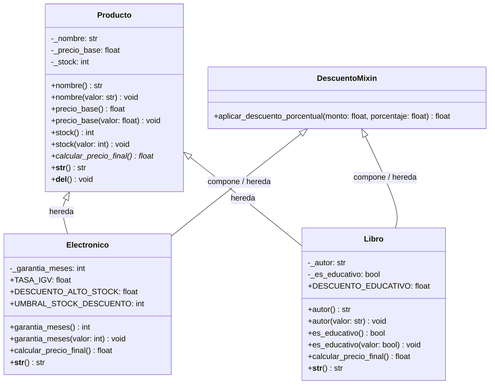

# NexusStore Core CLI

**NexusStore Core** es un sistema por consola (CLI) desarrollado en Python para la administración de inventario, catálogo comercial y cálculo dinámico de precios para tiendas especializadas en productos de alta tecnología y literatura técnica.

El proyecto está diseñado bajo principios de Arquitectura Limpia y Programación Orientada a Objetos (POO), garantizando encapsulamiento estricto, polimorfismo de cálculo comercial, herencia múltiple mediante Mixins cooperativos y un control riguroso de excepciones de dominio.

---

## 📁 Estructura del Proyecto

```text
nexusstore-cli/
│
├── main.py                 # Orquestador del flujo CLI y punto de entrada
├── requirements.txt        # Especificación de versión de entorno y linters
├── README.md               # Documentación técnica y arquitectura del sistema
│
├── models/                 # Modelos de dominio
│   ├── __init__.py         # Exportación limpia de clases públicas
│   └── producto.py         # Jerarquía de clases (Producto, Electronico, Libro, DescuentoMixin)
│
└── utils/                  # Utilidades transversales
    ├── __init__.py         # Exportación del paquete de utilidades
    ├── exceptions.py       # Excepciones personalizadas del dominio
    └── validators.py       # Validadores y sanitizadores de entrada
```

---

## 🏛️ Diagrama de Clases UML

El siguiente diagrama detalla la arquitectura de clases, los modificadores de acceso, la relación de herencia con la clase base y la integración del Mixin:



---

## 🧬 Análisis de MRO (Method Resolution Order) y Linealización C3

En Python, la resolución de atributos y llamadas cooperativas mediante `super()` se calcula utilizando el algoritmo **C3 Linearization**.

### Resolución para `Electronico` y `Libro`:
Ambas clases heredan tanto de la clase base `Producto` como del componente reutilizable `DescuentoMixin`:

```python
class Electronico(Producto, DescuentoMixin):
    ...

class Libro(Producto, DescuentoMixin):
    ...
```

Al inspeccionar el orden de resolución en tiempo de ejecución:

```python
>>> Electronico.__mro__
(<class 'models.producto.Electronico'>, 
 <class 'models.producto.Producto'>, 
 <class 'models.producto.DescuentoMixin'>, 
 <class 'object'>)
```

### Comportamiento y ventajas de este diseño:
1. **Prioridad del Dominio Principal:** Cualquier método definido en `Producto` o en la subclase prevalece antes de consultar `DescuentoMixin`.
2. **Reutilización Horizontal sin Colisión de Estado:** `DescuentoMixin` no define su propio `__init__` con atributos incompatibles, evitando el problema del diamante y permitiendo que `super().__init__(...)` delegue limpiamente en la clase base `Producto`.
3. **Determinismo:** El MRO garantiza que el cálculo de descuentos sea predecible y extensible para nuevas categorías de productos que requieran cálculos comerciales promocionales.

---

## ⚖️ Justificación Técnica: Herencia vs. Composición

En el diseño de este sistema se evaluó minuciosamente el uso de **Herencia** frente a **Composición**:

### 1. ¿Por qué Herencia para `Electronico` y `Libro` respecto a `Producto`?
- **Relación ontológica estricta ("Es un" / "Is-a"):** Un dispositivo electrónico y un libro técnico *son* variantes directas de un producto físico en el catálogo comercial: ambos tienen intrínsecamente un nombre, un precio base y un stock cuantificable.
- **Polimorfismo natural:** Permite que el orquestador (`main.py`) maneje una colección heterogénea `inventario: dict[int, Producto]` y ejecute `producto.calcular_precio_final()` y `str(producto)` sin necesidad de inspeccionar manualmente los tipos ni usar estructuras de control condicionales dispersas (`isinstance` o `switch`).

### 2. ¿Por qué un Mixin para `DescuentoMixin` en lugar de composición de servicios externa?
- La funcionalidad de descuento porcentual es un comportamiento auxiliar transversal que no posee estado persistente ni ciclo de vida independiente.
- Modelarlo como un **Mixin** permite dotar de capacidades matemáticas adicionales a las entidades sin acoplar la clase base `Producto` a una política de descuento obligatoria.

### 3. Consideraciones de Composición:
- Para escalas mayores donde los esquemas tributarios cambien con frecuencia regional (p. ej. pasarelas de pago multi-país), la regla impositiva podría desacoplarse mediante un patrón *Strategy* (`CalculadorImpuestos`). En el alcance actual, el polimorfismo por subclase garantiza máxima cohesión y mínima sobreingeniería.

---

## 🛡️ Encapsulamiento y Validaciones de Dominio

Los atributos internos se protegen mediante convenios de encapsulamiento (`_nombre`, `_precio_base`, `_stock`, `_garantia_meses`, `_autor`) y se exponen públicamente a través de decoradores `@property` y sus correspondientes setters:

- **`nombre` / `autor`:** Sanitización mediante `strip()`, garantizando que no se admitan cadenas vacías ni secuencias de espacios en blanco.
- **`precio_base`:** Validación numérica estricta que exige un valor estrictamente mayor a `0.0`.
- **`stock`:** Control de tipo entero y validación de rango no negativo (`stock >= 0`).
- **`garantia_meses`:** Entero positivo o cero (`garantia >= 0`).

---

## 🚦 Manejo Robusto de Excepciones (`try / except / else / finally`)

El flujo de interacción del orquestador en `main.py` está blindado contra datos corruptos y estados inválidos usando una jerarquía propia:

- **`ValidationError`:** Lanzada cuando una entrada no cumple con los tipos, rangos numéricos o reglas semánticas del negocio.
- **`NotFoundError`:** Lanzada cuando se consulta un identificador inexistente en el inventario.
- **Estructura de cuatro ramas (`try / except / else / finally`):**
  - `try`: Solicita inputs y ejecuta las operaciones del catálogo.
  - `except`: Atrapa de manera granular `ValidationError`, `NotFoundError` o contingencias genéricas sin detener el programa.
  - `else`: Se ejecuta únicamente cuando la transacción concluyó sin excepciones.
  - `finally`: Garantiza la emisión de avisos de estado y cierre de ciclo en cada iteración del menú.

---

## 🖥️ Evidencias de Ejecución

### 1. Caso Exitoso (Ruta Feliz): Creación, Listado y Cotización Polimórfica

```text
Iniciando Sistema de Gestión de Productos...

==========================================
=== GESTIÓN DE PRODUCTOS (CLI) ===
==========================================
1. Agregar Producto
2. Listar Productos
3. Calcular Precio Final
4. Salir
------------------------------------------
Opción > 1
Ingrese categoría (electronico / libro): electronico
Nombre del producto: Monitor Gamer 27 Pulgadas
Precio base (S/): 1200
Cantidad en stock: 55
Meses de garantía: 36

✅ Producto agregado con éxito. Asignado con ID #1.

==========================================
=== GESTIÓN DE PRODUCTOS (CLI) ===
==========================================
1. Agregar Producto
2. Listar Productos
3. Calcular Precio Final
4. Salir
------------------------------------------
Opción > 1
Ingrese categoría (electronico / libro): libro
Nombre del producto: Clean Code
Precio base (S/): 120
Cantidad en stock: 15
Autor del libro: Robert C. Martin
¿Es libro educativo / texto técnico? (s/n): s

✅ Producto agregado con éxito. Asignado con ID #2.

==========================================
=== GESTIÓN DE PRODUCTOS (CLI) ===
==========================================
1. Agregar Producto
2. Listar Productos
3. Calcular Precio Final
4. Salir
------------------------------------------
Opción > 2

---------------------------------------------------------------------------
ID     | DETALLE Y ESPECIFICACIONES                                       
---------------------------------------------------------------------------
#1     | [Electronico] Monitor Gamer 27 Pulgadas | S/ 1200.00 | Stock: 55 | Garantía: 36 meses (Descuento por stock > 50 aplicable)
#2     | [Libro] Clean Code | S/ 120.00 | Stock: 15 | Autor: Robert C. Martin | Tipo: Educativo / Técnico (Exento IGV)
---------------------------------------------------------------------------
Total de registros: 2

==========================================
=== GESTIÓN DE PRODUCTOS (CLI) ===
==========================================
1. Agregar Producto
2. Listar Productos
3. Calcular Precio Final
4. Salir
------------------------------------------
Opción > 3
Ingrese el ID del producto a cotizar: 1

--------------------------------------------------
💰 COTIZACIÓN DE PRECIO FINAL: ID #1
--------------------------------------------------
• Producto       : Monitor Gamer 27 Pulgadas
• Categoría      : Electronico
• Precio Base    : S/ 1200.00
• Stock Actual   : 55 unidades
• Descuento Vol. : -10.0% (Stock > 50)
• Tasa Impuesto  : IGV (18%)
• Garantía       : 36 meses
--------------------------------------------------
➡️  PRECIO FINAL DE VENTA: S/ 1274.40
--------------------------------------------------

==========================================
=== GESTIÓN DE PRODUCTOS (CLI) ===
==========================================
1. Agregar Producto
2. Listar Productos
3. Calcular Precio Final
4. Salir
------------------------------------------
Opción > 3
Ingrese el ID del producto a cotizar: 2

--------------------------------------------------
💰 COTIZACIÓN DE PRECIO FINAL: ID #2
--------------------------------------------------
• Producto       : Clean Code
• Categoría      : Libro
• Precio Base    : S/ 120.00
• Stock Actual   : 15 unidades
• Autor          : Robert C. Martin
• Régimen Libro  : Educativo / Técnico (-10%) | Exonerado de IGV (0%)
--------------------------------------------------
➡️  PRECIO FINAL DE VENTA: S/ 108.00
--------------------------------------------------
```

---

### 2. Caso de Excepción Capturada 1: `ValidationError` (Categoría o Datos Inválidos)

```text
==========================================
=== GESTIÓN DE PRODUCTOS (CLI) ===
==========================================
1. Agregar Producto
2. Listar Productos
3. Calcular Precio Final
4. Salir
------------------------------------------
Opción > 1
Ingrese categoría (electronico / libro): componentes_pc

⚠️  Error de validación: Categoría no válida: 'componentes_pc'. Opciones disponibles: 'electronico', 'libro'.
ℹ️  Revise los datos ingresados e intente nuevamente.
```

---

### 3. Caso de Excepción Capturada 2: `NotFoundError` (Identificador Inexistente)

```text
==========================================
=== GESTIÓN DE PRODUCTOS (CLI) ===
==========================================
1. Agregar Producto
2. Listar Productos
3. Calcular Precio Final
4. Salir
------------------------------------------
Opción > 3
Ingrese el ID del producto a cotizar: 999

🔍 No encontrado: No existe ningún producto registrado con el ID #999.
ℹ️  Revise los datos ingresados e intente nuevamente.
```

---

### 4. Cierre del Sistema y Activación del Destructor `__del__`

```text
==========================================
=== GESTIÓN DE PRODUCTOS (CLI) ===
==========================================
1. Agregar Producto
2. Listar Productos
3. Calcular Precio Final
4. Salir
------------------------------------------
Opción > 4

Cerrando sistema... ¡Hasta luego!
🗑️  Destruyendo instancia: Monitor Gamer 27 Pulgadas
🗑️  Destruyendo instancia: Clean Code
```

---

## 🚀 Requisitos y Ejecución

- **Python:** Versión `>= 3.11` (compatible plenamente con Python 3.12, 3.13 y 3.14 con `@override`).
- **Instalación de dependencias (opcional):**
  ```bash
  pip install -r requirements.txt
  ```
- **Iniciar la aplicación:**
  ```bash
  python main.py
  ```

# SEMANA-10---PRACTICA--DAW---01

